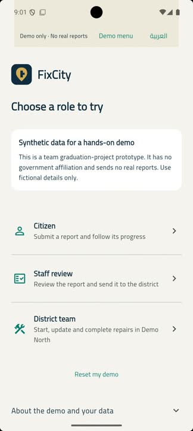

# FixCity

Team graduation project · Business Information Systems · Badr University in Cairo

FixCity is an Arabic and English Flutter prototype for reporting infrastructure problems in Egypt. A resident describes a problem, chooses a location and follows the report through staff review and district repair. The public demo uses fictional records and has no government affiliation.

## Try it

[Browser demo](https://mosalah-77.github.io/FixCity/) · [Android APKs, version 1.1.1](https://github.com/mosalah-77/FixCity/releases/tag/v1.1.1-demo.1) · [90-second Android recording](https://github.com/mosalah-77/FixCity/releases/download/v1.1.1-demo.1/fixcity-demo-1.1.1.mp4)

[](https://github.com/mosalah-77/FixCity/releases/download/v1.1.1-demo.1/fixcity-demo-1.1.1.mp4)

The recording follows a report from submission to repair without cuts or speed changes. It was captured by Mohamed in the Android emulator on 6 November 2026. The downloadable MP4 is a smaller, silent copy of that recording.

| Stage | Who acts | What happens |
| --- | --- | --- |
| Pending | Citizen, then staff | The citizen submits a report. Staff checks its details and evidence. |
| Sent to district | Staff | Staff hands off the report and can continue reading its history. |
| In progress | District team | The district starts repair and can add progress notes without closing the report. |
| Resolved | District team | A completion note and repair photo close the report. The citizen can see the outcome. |

Photos can accompany the first update and remain beside the relevant history entry. An inspection photo is separate from the final repair evidence.

Follow the [two-minute walkthrough](docs/DEMO.md) to try it yourself. Report data, history and in-app notifications are saved in a separate Supabase project. Each visitor sees only their own synthetic workspace. Sample illustrations replace camera uploads, and data expires after seven days. The free backend can pause after inactivity; check the link before sharing it in an application.

## Project origin and credit

This is Mohamed Elmorshedy's portfolio copy of a **six-person team project**. The original repository is [moatazahmedshaker/Fixcity](https://github.com/moatazahmedshaker/Fixcity). Its README credits **Ahmed Wael Ali ([DoctorJhin](https://github.com/DoctorJhin))** as developer. Those credits remain attached to this copy.

The source snapshot comes from commit [`a414da9`](https://github.com/moatazahmedshaker/Fixcity/commit/a414da9ffc3f2eab69e1cb2f4ef6c676d73b4e27). The upstream history records Ahmed Wael and DoctorJhin as author names, with Claude Sonnet 4.6 credited on one commit. A new history was created for this copy to avoid carrying credentials and archived data from the original repository. It does not reassign authorship of the original code.

See [ATTRIBUTION.md](ATTRIBUTION.md) for provenance and the limits of individual attribution.

## My contribution

I helped develop the concept and planned the reporting flow. With five colleagues, I contributed to technical direction, AI-assisted implementation, debugging and presentations. I hand-wrote portions of the frontend. Most of the team's code was produced with AI assistance, and we used a shared GitHub account for much of the work.

My contribution was shared with the team. This portfolio copy documents that work and the repairs I have since directed and reviewed with AI assistance.

## Work added to this portfolio copy

In November 2026, I used Codex to help turn the source snapshot into a reproducible demo and investigate bugs in the existing app. The work adds:

- Database migrations and row-level access policies for citizens, staff, districts and isolated demo visitors.
- Transactional report creation and status updates. A retried request does not award points or create history twice.
- Separate staff handoff and district repair permissions, progress notes that keep a report open, and photos on individual updates.
- Required repair evidence, private media rules for the separate normal-app path, and bounded demo accounts with expiry cleanup.
- Fixes for password handling, confirmation signup, unread notifications, stale tracking results, failed saves and small-screen layouts.
- A test suite, pinned builds and release documentation.
- A revised interface with four main destinations, Arabic typography, a desktop navigation rail and a new logo. The [design notes and logo options](docs/REDESIGN.md) explain those choices.
- A security review with fixes for concurrent media deletion and stale profile navigation, plus smaller Android downloads and bounded photo decoding. The [review record](docs/SECURITY-PERFORMANCE-REVIEW.md) explains the evidence and remaining checks.

The [release verification](docs/RELEASE-VERIFICATION.md) records the 1.1.1 builds, automated checks and live walkthrough. The [bug review](docs/BUG-REVIEW.md) separates reproduced defects from remaining checks, and the [backend guide](BACKEND-SETUP.md) describes access rules and limits. This is a student-project prototype developed with AI assistance. It has not been used for municipal operations.

## Run locally

Use **Flutter 3.35.7 / Dart 3.9.2** and the checked-in lockfile.

```sh
git clone https://github.com/mosalah-77/FixCity.git
cd FixCity/app
flutter pub get --enforce-lockfile
flutter run -d chrome --dart-define-from-file=demo-config.json
```

`demo-config.json` contains only a public client key and the isolated portfolio backend URL. For your own backend, follow [BACKEND-SETUP.md](BACKEND-SETUP.md), copy the config and change those public values. Never put a service-role key, database password or AI secret into the Flutter client.

```sh
flutter test --dart-define=DEMO_MODE=true
flutter test
flutter analyze --no-fatal-infos
flutter build web --release --base-href /FixCity/ --pwa-strategy=none \
  --dart-define-from-file=demo-config.json
```

See [release instructions](docs/RELEASE.md) for Android signing, database checks and deployment. The normal citizen/staff application remains in the codebase and needs its own configured backend and privately assigned roles. The public demo backend permits anonymous sign-in only.

## Stack and limits

Flutter/Dart, Supabase Auth/PostgreSQL/Storage, flutter_map, OpenStreetMap tiles, geolocator and image_picker. Map coordinates are ordinary latitude/longitude fields; no PostGIS behaviour is claimed. Category suggestions use a labelled local keyword fallback. The original Gemini integration is disabled, and old project credentials, archived data and binaries remain excluded.

There is no real incident delivery, SMS service or cash value attached to points. Physical-device performance, ordinary-account camera/GPS and hosted private uploads still need testing. The [security and performance review](docs/SECURITY-PERFORMANCE-REVIEW.md) records those limits.

## Licensing

The upstream README states "License: MIT", but the reviewed revision contains no standalone LICENSE file. This copy preserves that statement without inventing a copyright owner or changing the team's licensing terms. Confirm the complete licence with the project team before wider reuse.
